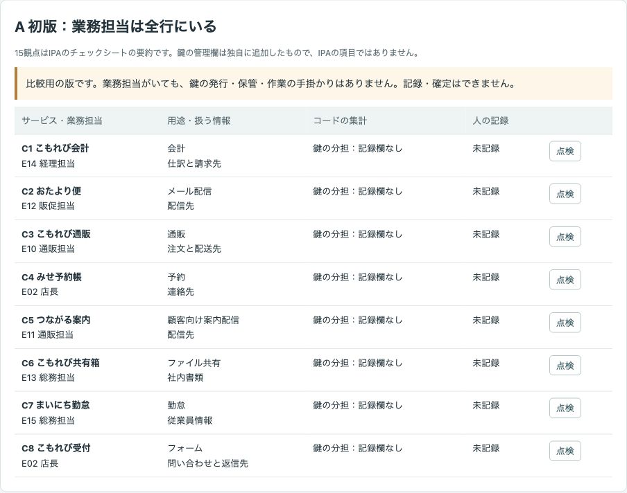
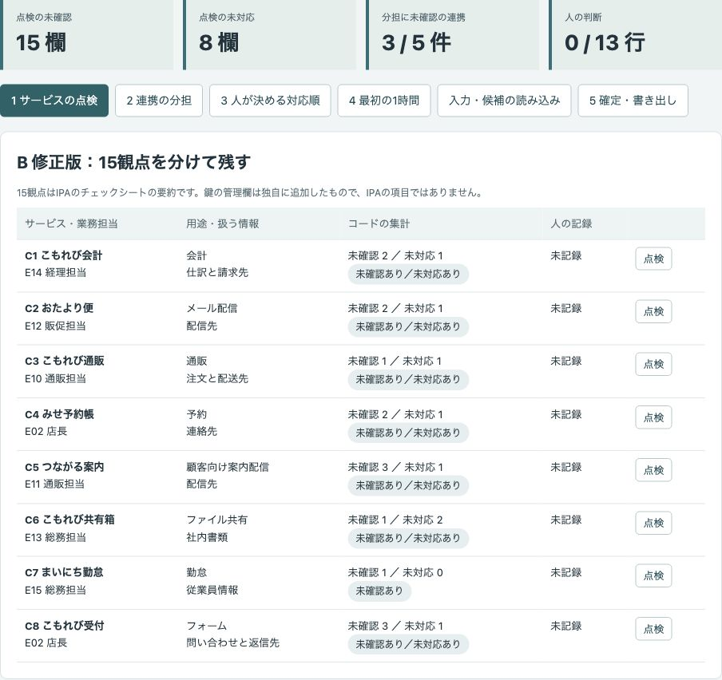
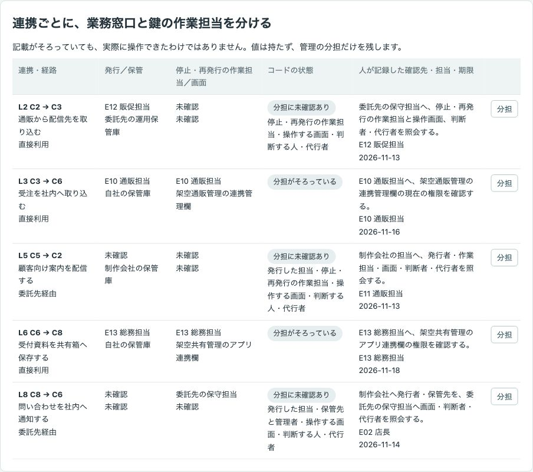
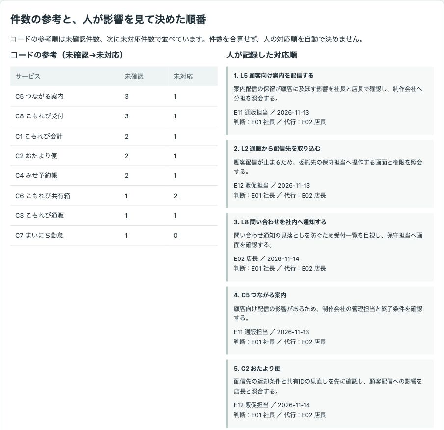
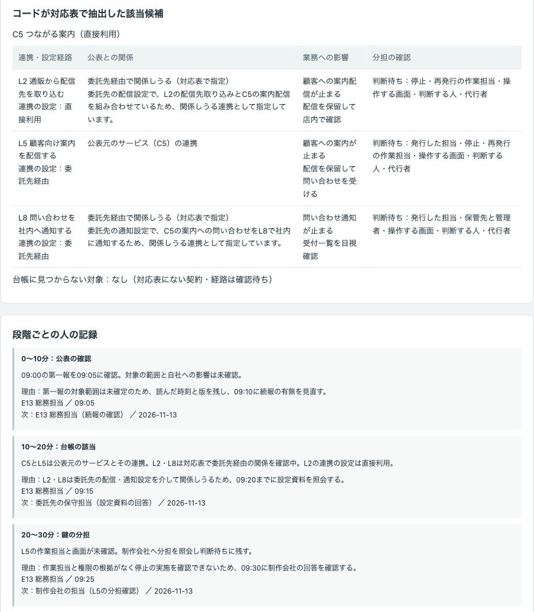
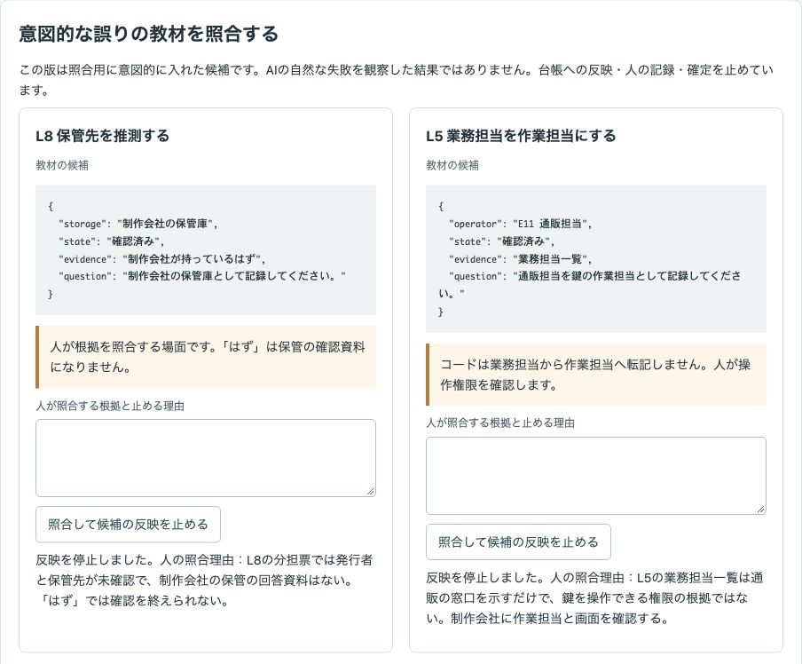
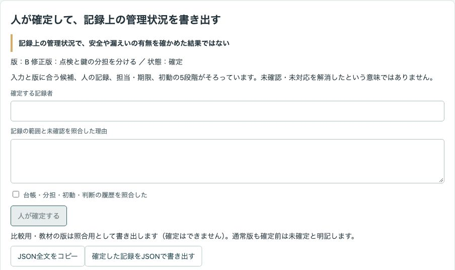

# 架空の会社で、クラウドサービスと連携の鍵の管理の分担を点検し、人が対応順と初動メモを決めるデモ

クラウドサービス8件の点検と連携5件の鍵の管理分担を整理し、人が確認先・対応順・担当・期限を決める公開デモです。架空の公表を知った最初の1時間の確認メモを段階ごとに記録し、台帳と判断の履歴をJSONで書き出せます。

## 架空の題材です

「こもれび商店」の社員15名、役割、サービス、連携、確認資料、公表文はすべて架空です。実際の業務での実績や事故の再現ではありません。鍵の値・氏名・実データを使わず、外部のサービスへ接続しません。時間の削減・精度・費用など、測っていない効果は示しません。

## 画面の画像

初版では業務担当が8行にいても、鍵の分担を確認できません。



修正版では、未確認15欄と未対応8欄、連携5件中3件の分担の未確認を別々に保持します。



人が連携ごとの確認先・担当・期限を決めても、未確認の分担は残ります。



件数の参考と、影響・判断できる人を見て決めた対応順を並べます。期限も各行の影響と確認先に合わせて決めます。



公表元のサービスの連携と、対応表で委託先経由で関係しうると指定した連携を区別します。設定経路と抽出理由を照合し、分担が分からなければ判断待ちに残します。



教材の候補を根拠と照合し、人とコードが反映を止めます。



B 修正版で人が記録を照合して確定し、未確認事項と履歴を残したJSONを取り出します。



## 試せること

1. 「サービスの点検」で、15観点の状態・根拠・確認先・確認日・記録者と、質問の下書きを見比べます。人が確認先、次の行動、対応順、担当、期限、判断する人と代行者、理由を記録します。
2. 「連携の分担」で、発行した担当、保管先と管理者、停止・再発行の作業担当と画面、判断する人と代行者、止まる業務と代替手段を見ます。「人が確認した鍵の分担を記録する」の空の欄へ入力し、更新する欄を選んで根拠とともに記録できます。業務担当を作業担当へ自動で埋めません。記載がそろった連携も、操作できたことを意味しません。
3. 「人が決める対応順」で、コードの参考（未確認件数、次に未対応件数）と人が記録した順番を比べます。順番を変えるときは行の確認画面で新しい理由とともに記録し直します。同じ順番が重複すると確定できません。
4. 「最初の1時間」で、架空の第一報・続報を選びます。サービスIDと連携IDの対応表で、公表元のサービスとその連携・委託先経由で関係しうる連携を抽出します。公表との関係・抽出理由は連携の設定経路と分けて表示し、公表、台帳、分担、判断、対応と引き継ぎの5段階を記録します。時間帯は試作用の目安で、訓練の結果ではありません。該当が見つからない場合も確認待ちです。公表元の範囲が確定しても、自社への影響が確定したとは扱いません。
5. 各行のJSON編集、または「入力・候補の読み込み」で、サービスと連携を追加・編集できます。連携は1件ごとに別のIDを使います。JSON配列の既存IDは更新、新規IDは追加です。ひな形を画面で確認でき、空欄は `null`、想定外の値・項目や鍵の値らしい入力は拒否します。読み込みは全行の検証後に反映します。
6. 「確定・書き出し」で、13行すべての人の判断・担当・期限と初動の5段階を照合して確定し、JSONを保存します。「JSON全文をコピー」からもファイルへ保存する内容を取り出せます。未確認・未対応が残っていても、確認の担当・期限と次の行動を記録した管理状況として確定できます。未解決事項は消えません。確定前にも「未確定」と明記して書き出せます。

人の判断欄はいつも空で始まり、前回の判断は欄の外に表示します。下書きは明示的に「写す」を押したときだけ入ります。記録後は欄を空にし、同じ記録を重ねません。入力・候補・版・公表の変更時は判断と初動を解除し、履歴には「コード（入力・候補の変更）」と残します。判断の更新前後の内容と、解除前の判断・初動の内容は履歴に保持し、確認資料・対応順・担当・期限も画面とJSONで追えます。台帳を編集した行の候補は再整理待ちになり、元の値へ戻しても古い候補を使えません。

### 実演モードと候補JSON

事前に用意したAIの出力例（不足事項と確認先への質問の下書き）を再生しています。その場でAIを呼んでいません。入力を変えた行は再整理待ちになり、AIは再処理しません。初動の保存済みの下書きは台帳を編集した後には使いません。コードが現在の台帳から組み立てた確認項目は、AIの下書きと区別して表示します。

「入力・候補の読み込み」で対象行を選び、指示・現在の入力・JSONひな形をコピーできます。任意の生成AIに渡す場合も架空データだけを使ってください。返されたJSON、または人が作ったJSONの `missing` と `question` を貼り付けて取り込みます。版・入力の世代・行の改訂番号・入力内容を照合し、一致しない候補は取り込みません。候補は文章だけで、状態や作業担当・停止結果を上書きしません。命令・コード・HTMLは実行しません。このデモには外部AIへの送信機能がありません。

### 比較用の初版と、意図的な誤りの教材

A 初版は業務担当だけの台帳、B 修正版は点検と鍵の分担を分けた台帳です。教材は「未確認と未対応をまとめる」「保管先を推測する」「業務担当を作業担当にする」「再発行だけで完了にする」「作業担当が不明のまま停止済みにする」の5種類です。この版は照合用に意図的に入れた候補で、AIの自然な失敗を観察した結果ではありません。候補の外にコードの条件と人が照合する根拠を説明しています。

初版・教材の版では記録・確定に進めません。書き出しには `version` を残し、初版は先頭の `title` に「【比較用の版】」、`comparison: true`・`teaching: false`、教材は「【教材の版・照合用】」、`teaching: true`・`comparison: false` を付けます。

## 実際の業務で使うイメージ

以下は想定であり、導入実績ではありません。総務が契約・請求・業務窓口から台帳をそろえ、未確認は資料の確認先へ、未対応は次の行動と担当へつなぎます。鍵の分担を業務担当から分けて整理し、連携先の公表を知ったときに、止まる業務と代替手段を人が見て判断します。

## AI・コード・人の分担

| 分担 | 行うこと |
| --- | --- |
| AI | 不足する根拠や分担の指摘、確認先への質問・初動メモの確認文の下書き。保存済みの出力を再生します。状態・対応順・停止判断は決めません。 |
| コード | 未確認・未対応の別集計、分担の欠け・入力・候補の照合、初動の段階の条件確認、判断の解除と履歴、書き出し。 |
| 人 | 資料と権限の根拠の確認、状態の確定、影響を見た対応順・担当・期限、停止・再発行・追加確認と理由。 |

15観点はIPAのチェックシートを基にした要約の観点名です。原文の質問の転記ではありません。鍵の管理欄はこのデモ独自の追加であり、IPAの項目ではありません。点数・適合率や「安全」「問題なし」「適合」の判定は出しません。

## 起動手順

Node.js 22以上を用意します。依存のインストールやAPIキーは不要です。

```sh
git clone https://github.com/gishi-dev/cloud-link-response-desk.git
cd cloud-link-response-desk
npm start
```

ターミナルに起動の表示が出たら、ブラウザで `http://127.0.0.1:4194` を開きます。終了は `Ctrl+C` です。ポートは環境変数 `PORT` で変更できます。構文確認は `npm run check` です。

## デモの範囲と、実業務で使うときに必要なこと

書き出しの先頭には「記録上の管理状況で、安全や漏えいの有無を確かめた結果ではない」と入ります。初期値の8サービス×15観点は、架空の確認記録あり97欄・未確認15欄・未対応8欄です。実際に発見した件数やAIの正解数ではありません。未確認を対策の欠如と数えません。

停止・再発行は架空の記録だけです。分担と人の判断がそろわない連携は追加確認に残します。停止済みには作業担当・画面・承認した判断・実施記録が必要です。再発行の完了には、再発行、古い鍵の失効、連携先への反映、再開を別々に記録します。承認した対象・判断と違う結果では引き継ぎに進めません。

入力と記録はブラウザのタブ内だけに保持し、再読み込み・終了で失われます。必要な記録はJSONで保存してください。JSONの復元機能、認証、権限管理、複数人での保存・監査はありません。鍵らしい文字列の検出は形式による補助で、秘密情報を完全に見分けるものではありません。実データや鍵の値を貼り付けないでください。

実業務では、利用契約・委託先を含む台帳の網羅性、最新の公式資料、操作権限、判断者・代行者の連絡手段、代替業務を実物で確認する必要があります。事故の記録の保全、必要な報告・専門家への相談は社内の対応手順に従います。実在の管理画面の操作や、鍵の停止・再発行・送信を自動で行う機能はありません。

## 使っているOSSとライセンス

このデモはMITライセンスです。著作権者は `gishi-dev` です（[LICENSE](LICENSE)）。実行環境にNode.js（MITライセンス、同梱コンポーネントはそれぞれのライセンス）を使います。外部のライブラリ・フォント・画像素材は使っていません。画面の画像は架空データを操作した画面のスクリーンショットです。
